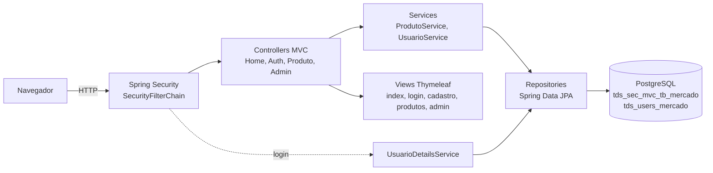
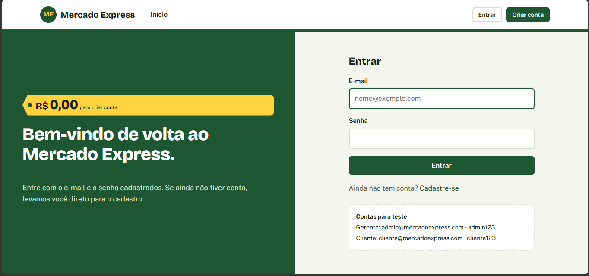
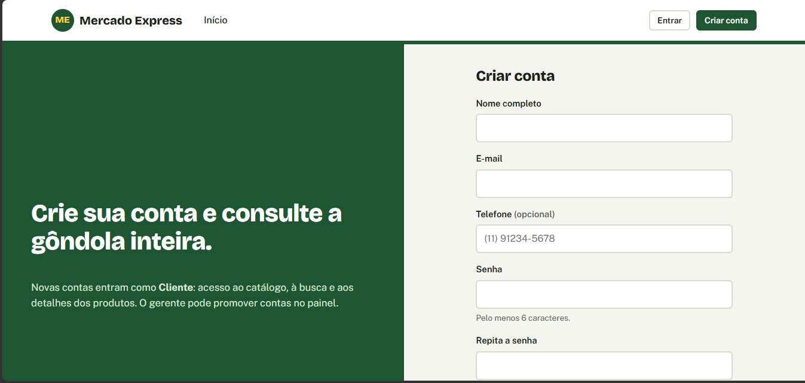
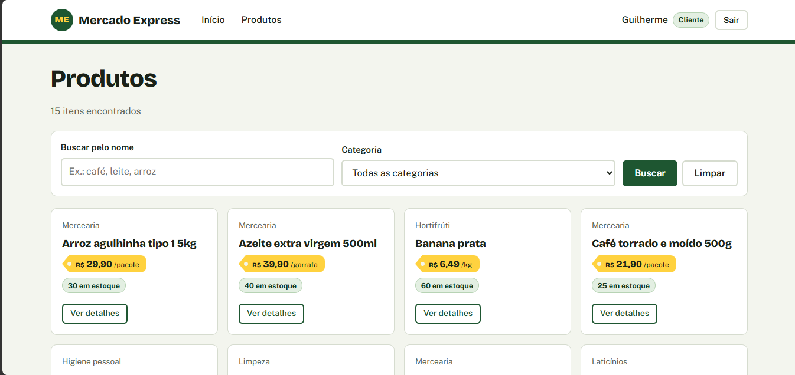
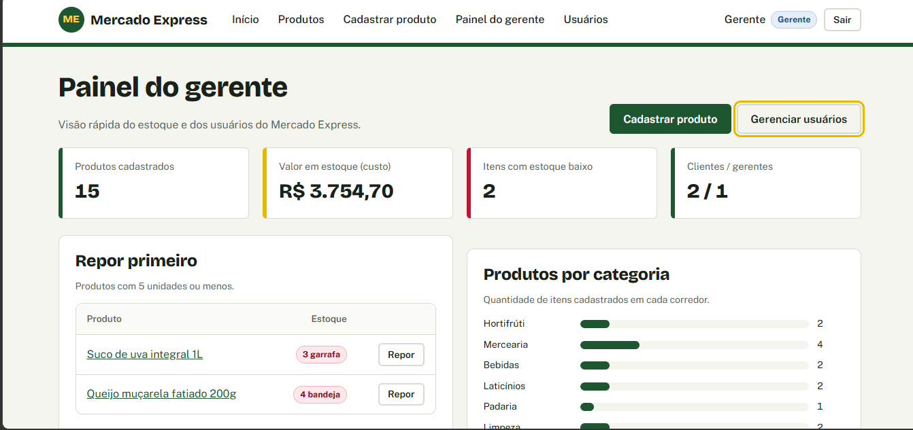
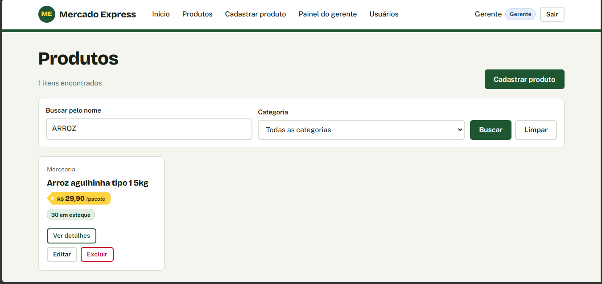
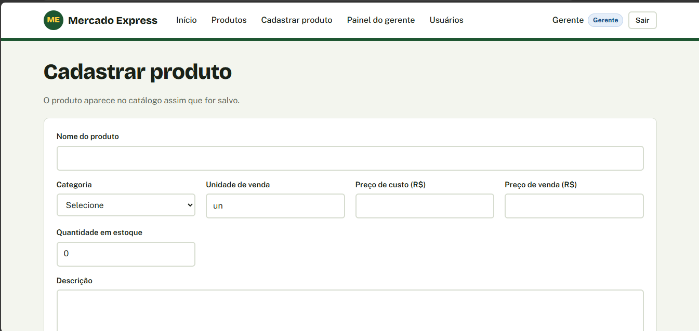
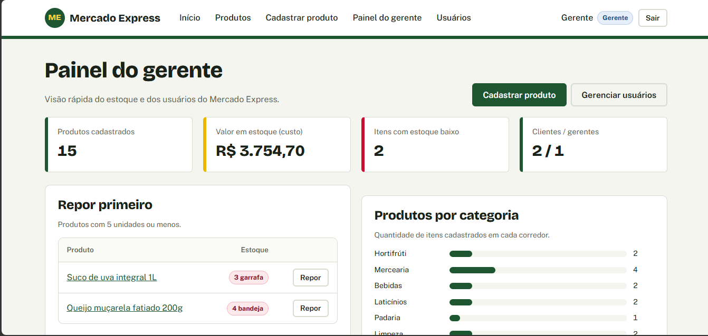

# Mercado Express · Spring Security MVC + PostgreSQL

**CP5 · Parte 1 — Java Advanced (FIAP · TDS)** · Prof. Dr. Marcel Stefan Wagner

Aplicação web do **Mercado Express**, um mercadinho de bairro, construída com **Spring Boot MVC + Thymeleaf**, protegida por **Spring Security** com **tela de login própria**, **tela de cadastro (Sign Up)**, **dois perfis de usuário** e **CRUD completo de produtos** gravado no **PostgreSQL**.

| Item | Valor |
|---|---|
| Deploy (produção) | `https://mercado-express-security.onrender.com` |
| IDE utilizada | IntelliJ IDEA |
| Linguagem / Build | Java 17 · Maven |
| Framework | Spring Boot 3.5.6 |
| Banco de dados | PostgreSQL 16 |
| Plataforma de deploy | Render (Web Service Docker + PostgreSQL) |

## Integrantes

| Nome                      | RM       |
|---------------------------|----------|
| HENRIQUE MARTINS OLIVEIRA | RM563620 |
| GUILHERME MACEDO MARTINS  | RM562396 |
| PEDRO HENRIQUE LUIZ ALVES | RM563405 |

---

## 1. Configuração do Spring Initializr

Projeto criado em <https://start.spring.io> com:

- **Project:** Maven · **Language:** Java · **Spring Boot:** 3.5.x · **Packaging:** Jar · **Java:** 17
- **Group:** `br.com.fiap` · **Artifact:** `mercado-express-security` · **Package name:** `br.com.fiap.mercadoexpress`
- **Dependências:** Spring Web, Thymeleaf, Spring Security, Spring Data JPA, Validation, PostgreSQL Driver, Lombok, Spring Boot DevTools
  (ao escolher Thymeleaf + Security o Initializr adiciona sozinho o `thymeleaf-extras-springsecurity6`)


---

## 2. Funcionalidades

- **Landing page pública** (`index.html`) com acesso ao login e ao cadastro.
- **Login personalizado** (`login.html`) no lugar da tela padrão do Spring Security.
- **Sign Up** (`cadastro.html`): quem não tem conta se cadastra; a conta é salva em `tds_users_mercado` com a senha criptografada em **BCrypt**.
- **Redirecionamento automático para o cadastro**: se alguém tentar entrar com um e-mail que não existe no banco, o `LoginFalhaHandler` envia a pessoa para `/cadastro` com o e-mail já preenchido.
- **Dois perfis** com acessos diferentes (veja a seção 4).
- **Redirecionamento pós-login por perfil**: gerente vai para `/admin/dashboard`, cliente vai para `/produtos`.
- **CRUD de produtos** com links e botões na interface: cadastrar, listar, buscar por nome/categoria, ver detalhes, editar e excluir.
- **Consulta de produto**: ao abrir um produto, o sistema consulta a tabela `tds_sec_mvc_tb_mercado` e mostra preço, estoque, categoria, descrição, margem de lucro (só para o gerente) e datas.
- **Painel do gerente** com valor do estoque, itens para repor e produtos por categoria.
- **Gestão de usuários**: o gerente promove clientes a gerente (ou o contrário).
- **Validações** com Bean Validation e mensagens em português; **CSRF** ativo em todos os formulários.

---

## 3. Arquitetura



```
src/main/java/br/com/fiap/mercadoexpress
├── MercadoExpressSecurityApplication.java
├── config/DataSeeder.java              # cria admin, cliente demo e produtos de exemplo
├── controller/
│   ├── HomeController.java             # /, /index, /login, /acesso-negado
│   ├── AuthController.java             # /cadastro (Sign Up)
│   ├── ProdutoController.java          # CRUD /produtos
│   ├── AdminController.java            # /admin/dashboard, /admin/usuarios
│   └── GlobalExceptionHandler.java
├── dto/CadastroForm.java
├── model/  Produto, Usuario, Categoria, Perfil
├── repository/  ProdutoRepository, UsuarioRepository
├── security/
│   ├── SecurityConfig.java             # regras de acesso, login e logout
│   ├── UsuarioDetailsService.java      # busca o usuario no PostgreSQL
│   ├── UsuarioLogado.java              # UserDetails com nome e perfil
│   ├── LoginSucessoHandler.java        # redireciona por perfil
│   └── LoginFalhaHandler.java          # e-mail inexistente -> /cadastro
└── service/  ProdutoService, UsuarioService
src/main/resources
├── application.yml
├── static/css/style.css
└── templates/  index, login, cadastro, produtos/*, admin/*, erro/*, fragments/layout
```

---

## 4. Perfis de usuário e rotas

| Rota | Método | Público | CLIENTE | ADMIN (gerente) |
|---|---|:-:|:-:|:-:|
| `/` e `/index` (landing page) | GET | ✅ | ✅ | ✅ |
| `/login` (tela personalizada) | GET/POST | ✅ | ✅ | ✅ |
| `/cadastro` (Sign Up) | GET/POST | ✅ | ✅ | ✅ |
| `/produtos` (listar e buscar) — **Read** | GET | ❌ | ✅ | ✅ |
| `/produtos/{id}` (consultar produto) — **Read** | GET | ❌ | ✅ | ✅ |
| `/produtos/novo` — **Create** | GET/POST | ❌ | ❌ | ✅ |
| `/produtos/{id}/editar` — **Update** | GET/POST | ❌ | ❌ | ✅ |
| `/produtos/{id}/excluir` — **Delete** | POST | ❌ | ❌ | ✅ |
| `/admin/dashboard`, `/admin/usuarios` | GET/POST | ❌ | ❌ | ✅ |

Usuários criados automaticamente na primeira execução:

| Perfil | E-mail | Senha |
|---|---|---|
| Gerente (ADMIN) | `admin@mercadoexpress.com` | `admin123` (no Render: valor de `ADMIN_SENHA`) |
| Cliente | `cliente@mercadoexpress.com` | `cliente123` |

Quem tenta abrir uma rota sem permissão cai na página `/acesso-negado`; quem não está logado é levado ao `/login`.

---

## 5. Implementação da tela de login

### 5.1 Configuração do Spring Security (`SecurityConfig.java`)

```java
http
    .authorizeHttpRequests(auth -> auth
        .requestMatchers("/", "/index", "/login", "/cadastro", "/error",
                "/css/**", "/js/**", "/img/**", "/favicon.ico").permitAll()
        .requestMatchers("/admin/**").hasRole("ADMIN")
        .requestMatchers("/produtos/novo", "/produtos/*/editar", "/produtos/*/excluir").hasRole("ADMIN")
        .requestMatchers("/produtos", "/produtos/**").hasAnyRole("ADMIN", "CLIENTE")
        .anyRequest().authenticated())
    .formLogin(form -> form
        .loginPage("/login")              // nossa tela, nao a padrao do framework
        .loginProcessingUrl("/login")
        .usernameParameter("email")
        .passwordParameter("senha")
        .successHandler(sucessoHandler)   // redireciona por perfil
        .failureHandler(falhaHandler)     // e-mail inexistente -> cadastro
        .permitAll())
    .logout(logout -> logout.logoutUrl("/logout").logoutSuccessUrl("/login?logout"))
    .exceptionHandling(ex -> ex.accessDeniedPage("/acesso-negado"));
```

Os controllers de escrita também usam `@PreAuthorize("hasRole('ADMIN')")` (`@EnableMethodSecurity`), então a regra é verificada na URL **e** no método.

### 5.2 Formulário (`templates/login.html`)

```html
<form th:action="@{/login}" method="post">
    <input type="email" name="email" required>
    <input type="password" name="senha" required>
    <button type="submit">Entrar</button>
</form>
```

O `th:action` do Thymeleaf injeta o token **CSRF** automaticamente.

### 5.3 Busca do usuário no banco (`UsuarioDetailsService.java`)

```java
public UserDetails loadUserByUsername(String email) {
    return repository.findByEmailIgnoreCase(email.trim())
            .map(UsuarioLogado::new)
            .orElseThrow(() -> new UsernameNotFoundException("Usuário não encontrado: " + email));
}
```

`UsuarioLogado` implementa `UserDetails` e devolve a autoridade `ROLE_ADMIN` ou `ROLE_CLIENTE`. O Spring Boot liga esse serviço ao `BCryptPasswordEncoder` declarado no `SecurityConfig`.

### 5.4 Quem não tem login vai para o cadastro (`LoginFalhaHandler.java`)

```java
if (email != null && !usuarioRepository.existsByEmailIgnoreCase(email.trim())) {
    response.sendRedirect(contexto + "/cadastro?naoCadastrado&email=" + emailCodificado);
    return;
}
response.sendRedirect(contexto + "/login?erro");
```

### 5.5 Destino após o login (`LoginSucessoHandler.java`)

```java
boolean admin = authentication.getAuthorities().stream()
        .anyMatch(a -> "ROLE_ADMIN".equals(a.getAuthority()));
response.sendRedirect(request.getContextPath() + (admin ? "/admin/dashboard" : "/produtos"));
```

### 5.6 Exemplos de uso

1. **Cliente novo:** em `/login` digite `novo@exemplo.com` e qualquer senha → o sistema abre `/cadastro` com o e-mail preenchido e o aviso "Não encontramos uma conta com esse e-mail". Depois do cadastro, volta ao login com a mensagem "Conta criada".
2. **Senha errada:** `cliente@mercadoexpress.com` + `123` → volta ao login com "E-mail ou senha incorretos".
3. **Cliente logado:** vai para `/produtos`; não vê os botões de cadastrar/editar/excluir e, se digitar `/admin/dashboard` na barra, cai em "Área exclusiva do gerente".
4. **Gerente logado:** vai para `/admin/dashboard` e tem o CRUD completo.




---

## 6. CRUD de produtos

| Operação | Tela | Endpoint | Tabela |
|---|---|---|---|
| **Create** | botão "Cadastrar produto" | `POST /produtos/novo` | `INSERT` em `tds_sec_mvc_tb_mercado` |
| **Read** | lista com busca + página de detalhes | `GET /produtos?busca=&categoria=` e `GET /produtos/{id}` | `SELECT` |
| **Update** | botão "Editar" | `POST /produtos/{id}/editar` | `UPDATE` |
| **Delete** | botão "Excluir" (com confirmação) | `POST /produtos/{id}/excluir` | `DELETE` |

Colunas da tabela `tds_sec_mvc_tb_mercado`: `id, nome, categoria, descricao, preco_custo, preco_venda, quantidade_estoque, unidade, ativo, criado_em, atualizado_em`.
Colunas da tabela `tds_users_mercado`: `id, nome, email, senha (BCrypt), telefone, perfil, ativo, criado_em`.
O script de referência está em [`sql/schema-referencia.sql`](sql/schema-referencia.sql) — o Hibernate cria as tabelas sozinho (`ddl-auto: update`).








---

## 7. Como executar localmente

Pré-requisitos: JDK 17+, Maven (ou IntelliJ) e Docker Desktop.

```bash
# 1) Subir o PostgreSQL
docker compose up -d

# 2) Rodar a aplicacao
mvn spring-boot:run
#   ou, no IntelliJ: abrir a pasta, esperar o Maven baixar as dependencias
#   e executar MercadoExpressSecurityApplication
```

Acesse <http://localhost:8080>.

`application.yml` (todos os valores podem vir de variáveis de ambiente):

```yaml
spring:
  datasource:
    url: jdbc:postgresql://${DB_HOST:localhost}:${DB_PORT:5432}/${DB_NAME:mercado_express}
    username: ${DB_USER:postgres}
    password: ${DB_PASSWORD:postgres}
  jpa:
    hibernate:
      ddl-auto: update
```

Sem Docker? Instale o PostgreSQL, crie o banco `mercado_express` (`CREATE DATABASE mercado_express;`) e ajuste usuário/senha.

---

## 9. Tecnologias

Java 17 · Spring Boot 3.5 · Spring MVC · Spring Security 6 · Spring Data JPA / Hibernate · Bean Validation · Thymeleaf + thymeleaf-extras-springsecurity6 · Lombok · PostgreSQL 16 · Docker · Render
